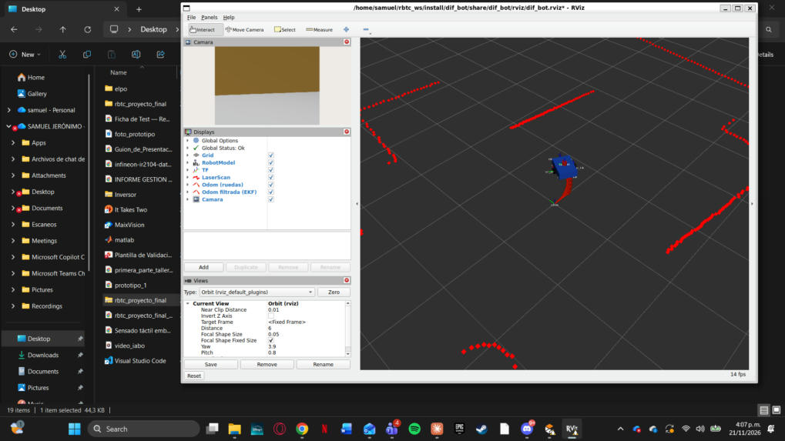
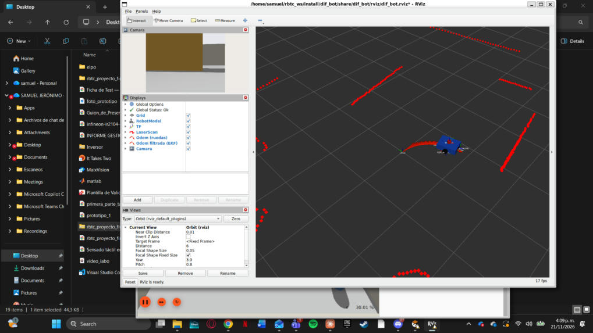

# Práctica 1: control y odometría del robot diferencial

**Objetivo:** comparar los dos métodos de control del robot: el plugin DiffDrive de Gazebo y `ros2_control` con `diff_drive_controller`.

[← Volver al índice](../README.md)

## Archivos de esta práctica

| Archivo | Qué contiene |
|---|---|
| [`robot.urdf.xacro`](../../src/dif_bot/urdf/robot.urdf.xacro) | Robot y condición `use_ros2_control` que elige el sistema de control |
| [`gz_control.xacro`](../../src/dif_bot/urdf/gz_control.xacro) | Plugin `gz::sim::systems::DiffDrive` + `JointStatePublisher` |
| [`ros2_control.xacro`](../../src/dif_bot/urdf/ros2_control.xacro) | Bloque `ros2_control` con `gz_ros2_control/GazeboSimSystem` |
| [`sensors.xacro`](../../src/dif_bot/urdf/sensors.xacro) | IMU, LiDAR 2D y cámara |
| [`controllers.yaml`](../../src/dif_bot/config/controllers.yaml) | `joint_state_broadcaster` y `diff_drive_controller` |
| [`sim.launch.py`](../../src/dif_bot/launch/sim.launch.py) | Gazebo, puentes ROS–Gazebo, `robot_state_publisher`, spawners y RViz |

## Cómo ejecutarla

```bash
# a) Plugin DiffDrive de Gazebo
ros2 launch dif_bot sim.launch.py use_ros2_control:=false

# b) ros2_control, activando los controladores a mano
ros2 launch dif_bot sim.launch.py use_ros2_control:=true spawn_controllers:=false
ros2 control load_controller --set-state active joint_state_broadcaster
ros2 control load_controller --set-state active diff_drive_controller

# Mover el robot
ros2 run teleop_twist_keyboard teleop_twist_keyboard --ros-args -p stamped:=true

# Comparar
ros2 topic info /odom -v
ros2 topic hz /odom
ros2 control list_controllers
```

## Resultados

| Medido con el robot en movimiento | DiffDrive de Gazebo | `ros2_control` |
|---|---|---|
| Publicador de `/odom` | `bridge_gz_control` (calculada en gz-sim) | `diff_drive_controller` |
| Publicador de la TF `odom` → `base_footprint` | `bridge_gz_tf` | `diff_drive_controller` |
| Frecuencia configurada / medida de `/odom` | 30 Hz / ~21 Hz | 50 Hz / ~19 Hz |
| Covarianza en `/odom` | no | sí (0.001 en v_x, v_y) |
| Timeout de comandos | no | 0.5 s |

Antes de `load_controller` no había controladores ni publicador de `/odom`. Después, ambos controladores quedaron `active` y el robot respondió a `/cmd_vel`. Las frecuencias medidas están por debajo de las configuradas porque la simulación corría al 20–35 % del tiempo real en WSL2.

## Capturas

**RViz con el plugin DiffDrive de Gazebo:** modelo, LiDAR sobre las paredes, rastro de odometría e imagen de la cámara.



**RViz con `ros2_control`** tras activar los controladores a mano y mover el robot en arco.


