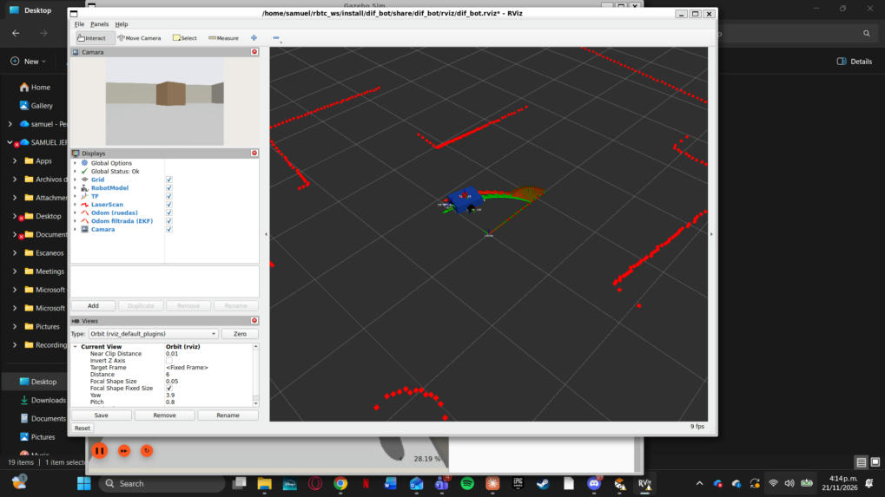

# Práctica 2: fusión sensorial con robot_localization

**Objetivo:** configurar un filtro EKF 2D que fusione la odometría de ruedas y la IMU para obtener una odometría más estable (`/odom_filtered`).

[← Volver al índice](../README.md)

## Archivos de esta práctica

| Archivo | Qué contiene |
|---|---|
| [`ekf.yaml`](../../src/dif_bot/config/ekf.yaml) | EKF 2D: `/odom` (v_x, v_y, velocidad angular en z) + `/imu` (velocidad angular en z, aceleración en x) |
| [`controllers_ekf.yaml`](../../src/dif_bot/config/controllers_ekf.yaml) | `diff_drive_controller` con `enable_odom_tf: false` para que la TF la publique el EKF |
| [`sim.launch.py`](../../src/dif_bot/launch/sim.launch.py) | Argumento `use_ekf:=true`: lanza `ekf_node` y remapea la salida a `/odom_filtered` |

## Cómo ejecutarla

```bash
ros2 launch dif_bot sim.launch.py use_ekf:=true
ros2 run teleop_twist_keyboard teleop_twist_keyboard --ros-args -p stamped:=true
ros2 topic echo /odom_filtered --field pose.pose.position
ros2 run tf2_ros tf2_echo odom base_footprint
```

Para probar sin IMU, comentar las líneas `imu0` de `ekf.yaml` y recompilar.

## Resultados

Se corrió en paralelo un segundo EKF igual pero sin la IMU (`/odom_noimu`). El robot avanzó recto, giró en el sitio e hizo una curva. Las tres estimaciones se compararon con la pose real que reporta Gazebo, (0.15, 0.58) m y 171.2°:

| Estimación | Error de posición (m) | Error de orientación (°) |
|---|---|---|
| `/odom` (solo ruedas) | 0.26 | 19.5 |
| EKF sin IMU (`/odom_noimu`) | 0.27 | 19.5 |
| **EKF con IMU (`/odom_filtered`)** | **0.09** | **6.6** |

- `/odom_filtered` sale con `frame_id: odom` y `child_frame_id: base_footprint`.
- El único publicador de la TF `odom` → `base_footprint` es `ekf_filter_node`.
- Sin IMU, el EKF queda prácticamente igual a la odometría de ruedas.

## Captura

Rastro de `/odom` (rojo) separándose del de `/odom_filtered` (verde) durante el giro.


