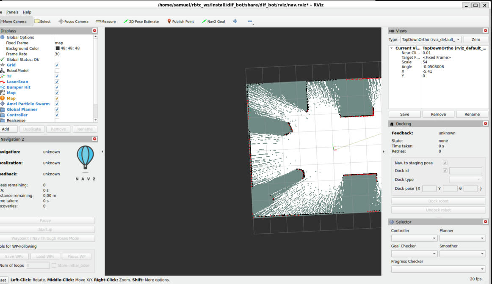
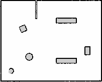

# Práctica 3: mapeo del entorno (SLAM)

**Objetivo:** generar un mapa navegable de la bodega con SLAM Toolbox y guardarlo en `maps/`.

[← Volver al índice](../README.md)

## Archivos de esta práctica

| Archivo | Qué contiene |
|---|---|
| [`warehouse.sdf`](../../src/dif_bot/worlds/warehouse.sdf) | Mundo: bodega de 10 × 8 m con estanterías, tabique, cajas, pilar y barril |
| [`slam_toolbox.yaml`](../../src/dif_bot/config/slam_toolbox.yaml) | SLAM Toolbox *online async*, resolución 0.05 m |
| [`slam.launch.py`](../../src/dif_bot/launch/slam.launch.py) | Lanza SLAM Toolbox y RViz |
| [`maps/warehouse.yaml`](../../src/dif_bot/maps/warehouse.yaml) · [`warehouse.pgm`](../../src/dif_bot/maps/warehouse.pgm) | Mapa generado |

## Cómo ejecutarla

```bash
ros2 launch dif_bot sim.launch.py use_ekf:=true rviz:=false
ros2 launch dif_bot slam.launch.py
ros2 run teleop_twist_keyboard teleop_twist_keyboard --ros-args -p stamped:=true
# recorrer toda la bodega a 0.3 m/s o menos, luego:
ros2 run nav2_map_server map_saver_cli -f ~/rbtc_ws/src/dif_bot/maps/warehouse
```

## Resultados

| Dato | Valor |
|---|---|
| Resolución | 0.05 m/celda |
| Tamaño | 203 × 163 celdas (10.15 × 8.15 m) |
| Origen | (−5.08, −4.08) m |
| Umbrales | `occupied_thresh` 0.65, `free_thresh` 0.196 |
| Recorrido | ~40 m a 0.3 m/s o menos, giros a 0.6 rad/s |
| Deriva de odometría corregida por SLAM | (0.67, 1.62) m y −17° en la TF `map` → `odom` al final |

El mapa coincide con el mundo, aunque la odometría derivó 1.6 m; el *scan matching* corrigió esa deriva.

## Capturas

**Mapa construyéndose en vivo en RViz** durante el recorrido.



**Mapa final guardado** con `map_saver_cli`.


