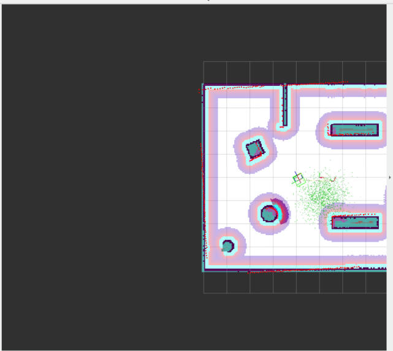
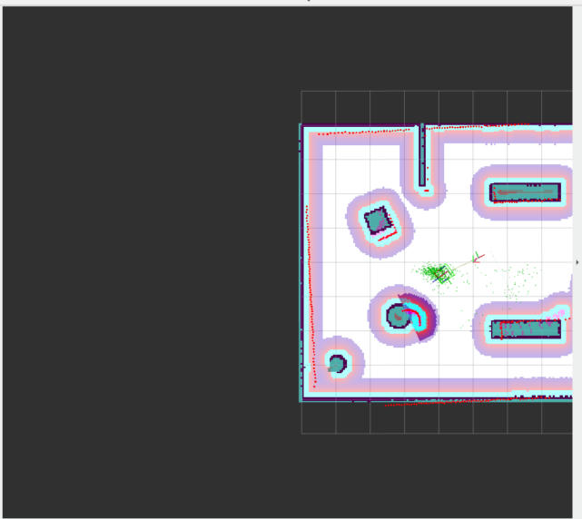
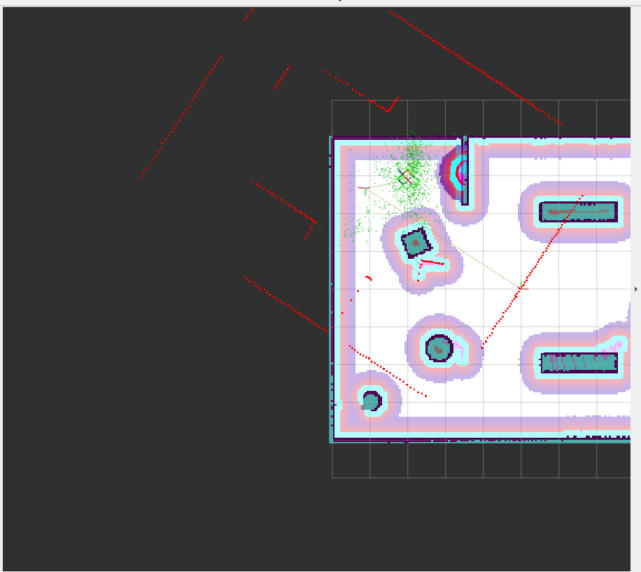

# Práctica 4: localización con AMCL

**Objetivo:** localizar el robot en el mapa de la Práctica 3 con AMCL y validar la convergencia en RViz.

[← Volver al índice](../README.md)

## Archivos de esta práctica

| Archivo | Qué contiene |
|---|---|
| [`amcl.yaml`](../../src/dif_bot/config/amcl.yaml) | AMCL (`DifferentialMotionModel`, 500–2000 partículas, `likelihood_field`) + `map_server` |
| [`localization.launch.py`](../../src/dif_bot/launch/localization.launch.py) | `map_server`, `amcl` y `lifecycle_manager` |

## Cómo ejecutarla

```bash
ros2 launch dif_bot sim.launch.py use_ekf:=true rviz:=false
ros2 launch dif_bot localization.launch.py rviz:=true
ros2 run teleop_twist_keyboard teleop_twist_keyboard --ros-args -p stamped:=true
```

Para la prueba de pose incorrecta, usar **2D Pose Estimate** en RViz sobre un punto equivocado y mover el robot. Para ruido del láser: `sim.launch.py laser_noise:=0.05`.

## Resultados

| Prueba | Error inicial | Error tras 5 movimientos | Resultado |
|---|---|---|---|
| Pose correcta | 0 | 0.03 m, 4° | localizado |
| Pose incorrecta moderada | 1.3 m, 46° | 0.26 m, 3° | converge en ~5 movimientos |
| Robot "secuestrado" (otro cuarto) | 3.7 m | 4.0 m, 146° | no converge: se queda en una hipótesis falsa |

Las poses incorrectas se publicaron en `/initialpose`, igual que *2D Pose Estimate*. El robot se movió con giros y avances cortos.

## Capturas

**Pose inicial incorrecta:** la nube de partículas (verde) está dispersa lejos del robot y el láser no encaja con el mapa.



**AMCL convergiendo** tras varios movimientos.



**Robot secuestrado:** AMCL convergió en el cuarto equivocado y el láser queda totalmente desalineado.


