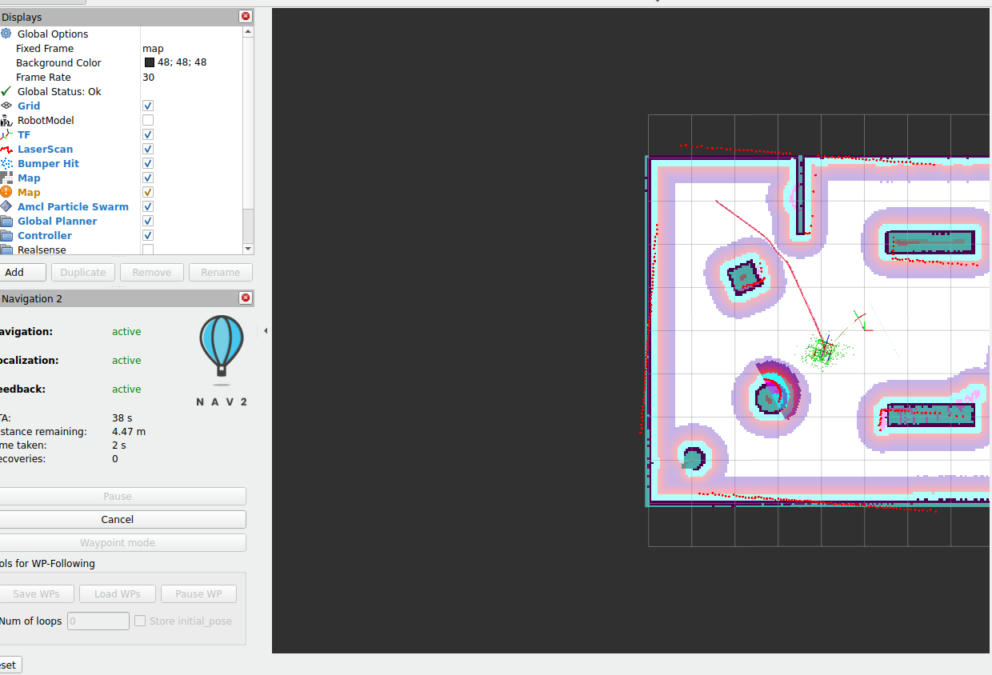
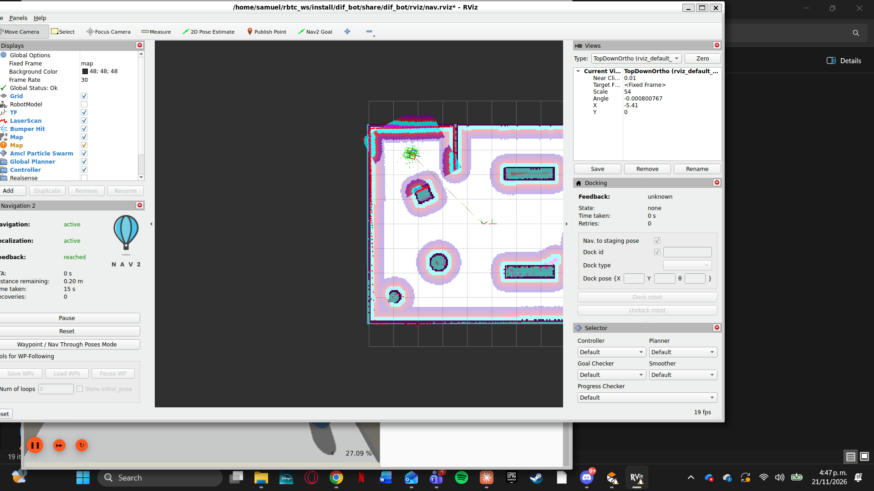
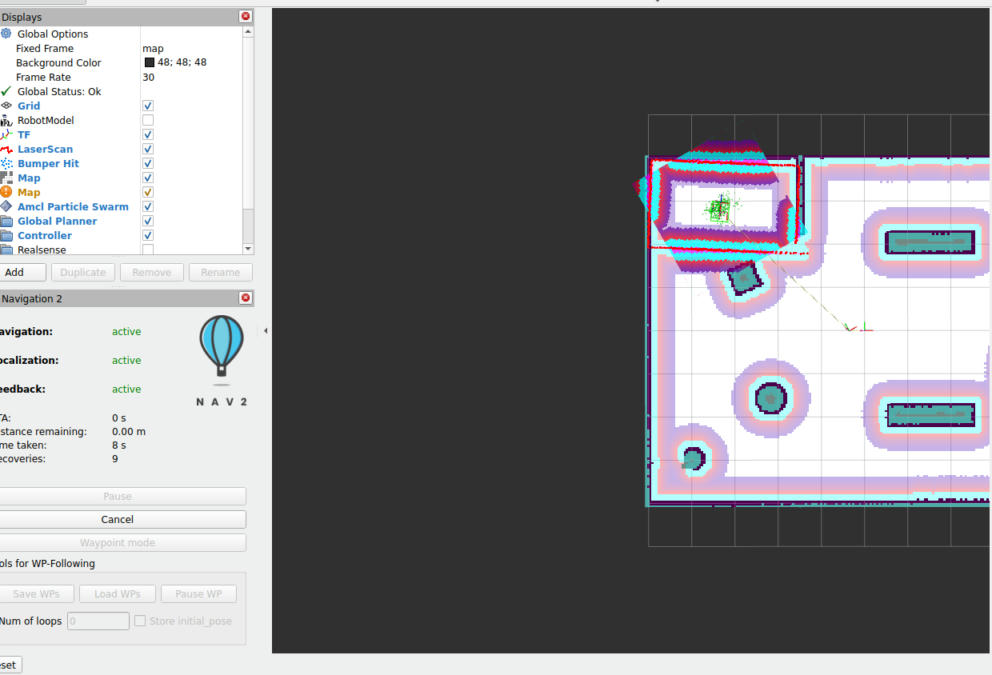

# Práctica 5: navegación autónoma con Nav2

**Objetivo:** configurar Nav2 (planner, controller y behavior trees) y enviar metas desde RViz.

[← Volver al índice](../README.md)

## Archivos de esta práctica

| Archivo | Qué contiene |
|---|---|
| [`nav2_params.yaml`](../../src/dif_bot/config/nav2_params.yaml) | Planner NavFn, controlador Regulated Pure Pursuit, costmaps, behavior server, BT navigator, velocity smoother |
| [`navigation.launch.py`](../../src/dif_bot/launch/navigation.launch.py) | Servidores de navegación + `lifecycle_manager` |
| [`bringup_nav.launch.py`](../../src/dif_bot/launch/bringup_nav.launch.py) | Todo en uno: Gazebo + EKF + AMCL + Nav2 + RViz |

## Cómo ejecutarla

```bash
ros2 launch dif_bot bringup_nav.launch.py
```

En RViz, usar **Nav2 Goal** para enviar una meta. Para ver recuperaciones, bloquear el paso del robot con un obstáculo en Gazebo.

## Configuración

| Componente | Configuración |
|---|---|
| Planificador global | NavFn (Dijkstra sobre el costmap global) |
| Controlador local | Regulated Pure Pursuit, 20 Hz, 0.4 m/s, *lookahead* 0.3–0.9 m |
| Costmap global | capa estática + obstáculos (LiDAR) + inflación de 0.55 m |
| Costmap local | 3 × 3 m móvil, obstáculos + inflación de 0.45 m |
| Behavior tree | `navigate_to_pose_w_replanning_and_recovery.xml`, replanifica a 1 Hz; `default_server_timeout` de 100 ms |

## Resultados

- **Meta desde RViz:** NavFn trazó una ruta de 4.45 m hacia el cuarto oeste, rodeando la caja y el tabique. El robot llegó con 0 recuperaciones.
- **Recuperaciones:** se creó en Gazebo una pared que encerraba al robot y se le pidió volver a la base. NavFn falló con el error 208 y el BT ejecutó en ciclo ClearCostmap → Spin (1.57 rad) → Wait (5 s) → BackUp (0.30 m). Tras 6 reintentos abortó la meta.

## Capturas

**Meta enviada con Nav2 Goal:** ruta planificada por NavFn (línea roja).



**Meta alcanzada:** estado *reached*, 0 recuperaciones.



**Robot encerrado:** el contador de recuperaciones sube mientras el BT ejecuta ClearCostmap, Spin, Wait y BackUp.


