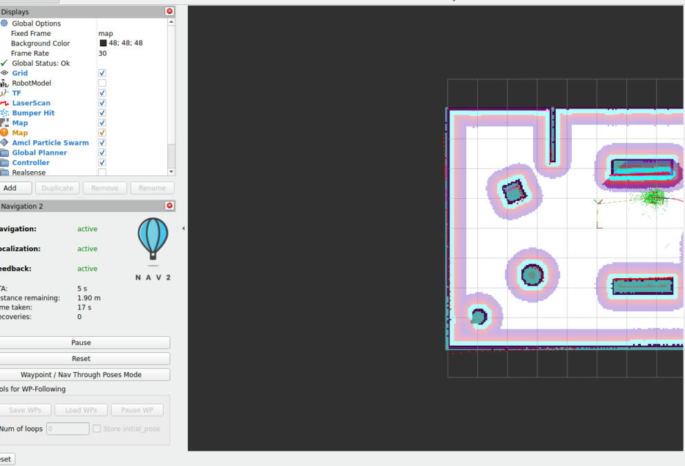
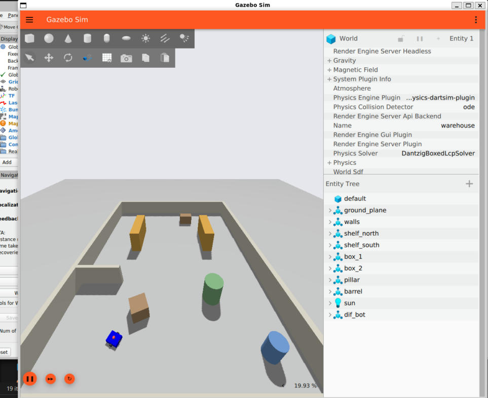

# Proyecto final: misiones autónomas

**Objetivo:** un nodo que ejecute de forma autónoma una secuencia de waypoints leída de un YAML, iniciada por un servicio.

[← Volver al índice](../README.md)

**Video demostrativo:** [video_mision_rbtc.mp4](../../video/video_mision_rbtc.mp4) (8 min 13 s, Gazebo + RViz + terminales).

## Archivos de esta práctica

| Archivo | Qué contiene |
|---|---|
| [`mission_node.py`](../../src/dif_bot_mission/dif_bot_mission/mission_node.py) | Nodo con `nav2_simple_commander` (`BasicNavigator`) y servicios `std_srvs/Trigger` |
| [`waypoints.yaml`](../../src/dif_bot_mission/config/waypoints.yaml) | Los 7 waypoints de la ronda, modo, vueltas y timeouts |
| [`mission.launch.py`](../../src/dif_bot_mission/launch/mission.launch.py) | Lanza el nodo con el archivo de waypoints |

| Requisito | Implementación |
|---|---|
| Nodo con `nav2_simple_commander` | `BasicNavigator`: `waitUntilNav2Active`, `goToPose`, `followWaypoints`, `cancelTask` |
| Servicio para iniciar la misión | `/mission/start`, más `/mission/cancel` y `/mission/reload` |
| Waypoints desde YAML | `config/waypoints.yaml` |
| Seguimiento en terminal o RQT | `/mission/status` (`std_msgs/String`) |

## Cómo ejecutarla

```bash
ros2 launch dif_bot bringup_nav.launch.py
ros2 launch dif_bot_mission mission.launch.py
ros2 service call /mission/start std_srvs/srv/Trigger
ros2 topic echo /mission/status
```

## Waypoints

| # | Waypoint | x (m) | y (m) | yaw (rad) | Espera (s) |
|---|---|---|---|---|---|
| 1 | Muelle este | 3.8 | 0.5 | 1.57 | 2 |
| 2 | Esquina noreste | 3.8 | 3.2 | 3.14 | 1 |
| 3 | Pasillo norte | −0.5 | 3.2 | −1.57 | 1 |
| 4 | Cuarto oeste | −3.5 | 3.0 | −1.57 | 2 |
| 5 | Zona de barriles | −4.0 | −1.5 | 0 | 1 |
| 6 | Pasillo sur | 0.0 | −3.2 | 0 | 1 |
| 7 | Base | 0.0 | 0.0 | 0 | 0 |

## Resultados

| Corrida | Waypoints alcanzados | Fallidos | Tiempo total |
|---|---|---|---|
| Video demostrativo (Gazebo, RViz y terminales, grabando) | 7/7 | 0 | 484.4 s |
| Gazebo y RViz abiertos, DiffDrive | 7/7 | 0 | 453.0 s |
| Sin interfaz gráfica, `ros2_control` | 7/7 | 0 | 162.1 s |
| Sin interfaz gráfica, DiffDrive | 7/7 | 0 | 179.6 s |

Los tiempos son de reloj de pared: con interfaz gráfica la simulación corre mucho más lenta en WSL2.

## Capturas

**Misión en curso en RViz:** robot localizado camino del primer waypoint.



**Misión en curso en Gazebo:** el robot cerca de la zona de barriles (waypoint 5).


